<div align="center">



<br>

<a href="https://fridaydeveloper.com"></a>
&nbsp;
<a href="mailto:hello@fridaydeveloper.com"></a>
&nbsp;
<a href="https://fridaydeveloper.com/imprint"></a>

</div>

```console
$ friday whoami --long
José · developer · Irvine · Telcabo Group

I build the software a business runs its day on — and then, at 1am, the thing
I just wanted to see exist. Both kinds ship. Nearly all of it is client work in
private repos, so there is not much to read here: the write-ups live on the site.
```

<div align="center">



</div>

```console
$ cat ~/.rules
reuse before build    native HTML → what's already in the repo → a library.
                      hand-rolling is the last rung, not the first.
compute on read       nothing on a timer. a screen that lies is worse than
                      a screen that is slow.
one canonical thing   same element, same component, every page. consistency is
                      a decision made upstream, not per screen.
plain over clever     no ORM where SQL is clearer. no component library where
                      40 lines of CSS does it. clever is what someone decodes at 3am.
smallest that works   no speculative abstraction, no config for a value that
                      never changes, no flexibility nobody asked for.
```

<div align="center">
<sub><code>&lt;f/&gt;</code> &nbsp;·&nbsp; if something there made you feel something, I'd like to know.</sub>
</div>
