 

&nbsp;

&nbsp;

 

### Stack

**Languages**

**Web**

**Mobile & desktop**

**Data**

**Infrastructure**

 

<code>&lt;f/&gt;</code> &nbsp;·&nbsp; if something there made you feel something, I'd like to know.

