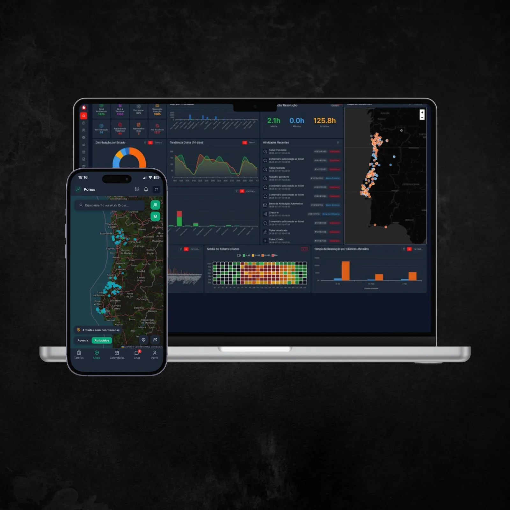
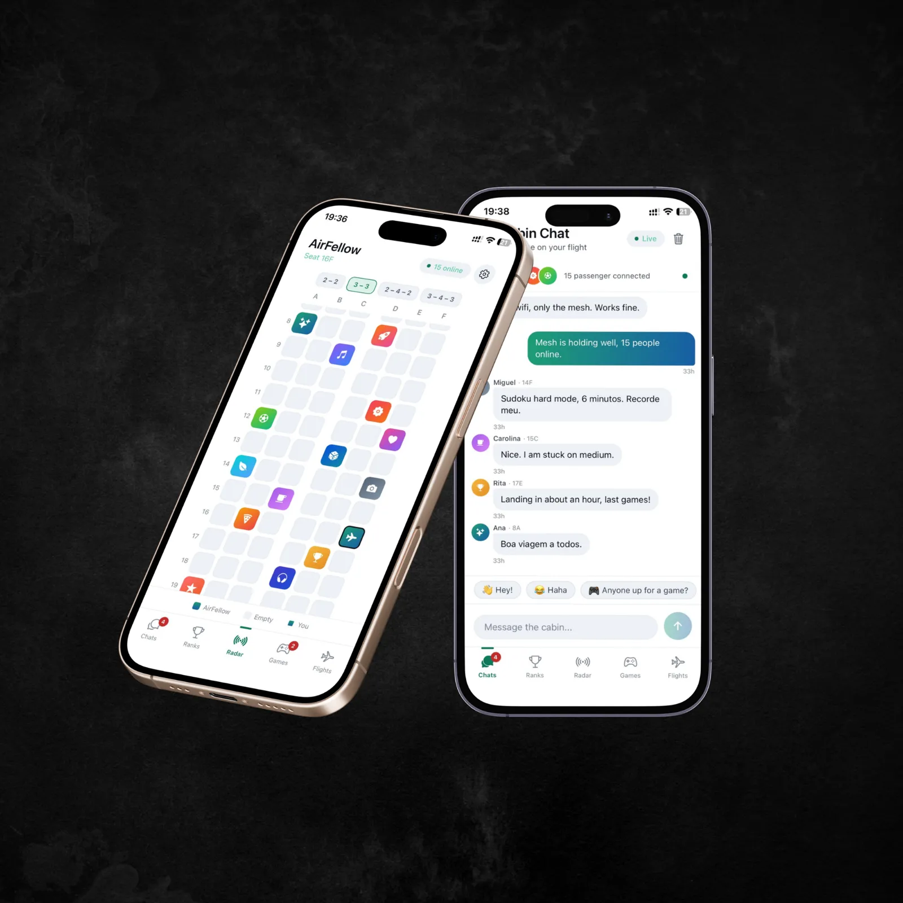
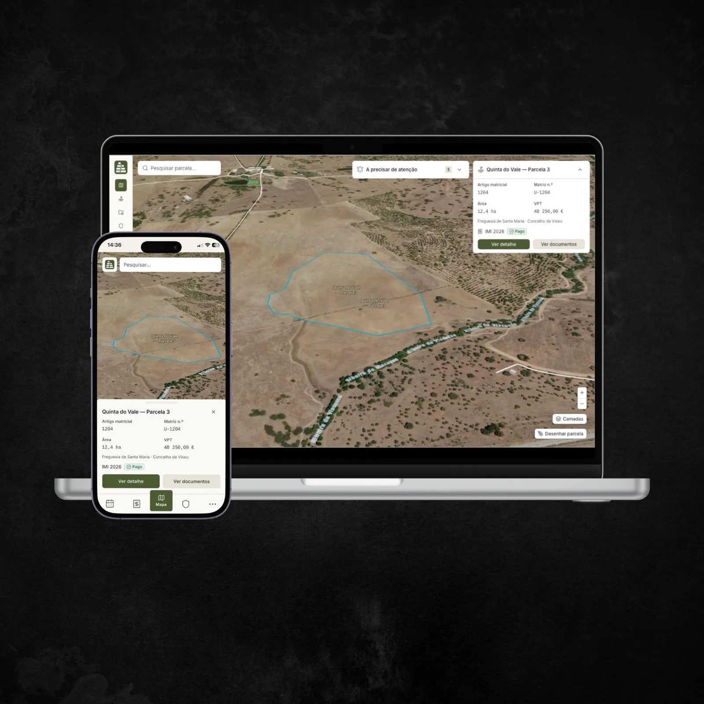
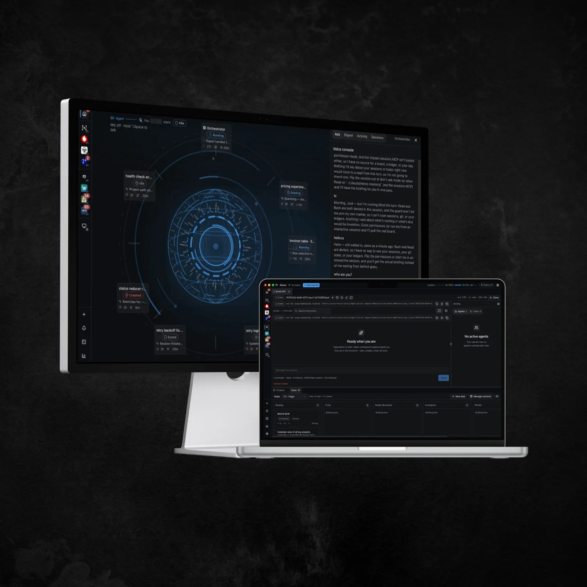

<div align="center">


<br>

<a href="https://fridaydeveloper.com"><b>fridaydeveloper.com</b></a> &nbsp;·&nbsp;
<a href="mailto:hello@fridaydeveloper.com">hello@fridaydeveloper.com</a> &nbsp;·&nbsp;
<a href="https://fridaydeveloper.com#work">work</a> &nbsp;·&nbsp;
<a href="https://fridaydeveloper.com/imprint">imprint</a>

</div>

<br>

I build the software a business actually runs its day on — and then, at 1am, the thing I just wanted to see exist. Both are below. Nearly all of it is client work in private repos, so this page is the index; the write-ups live on the site.

<br>

## Work

<table>
<tr>
<td width="50%" valign="top">

<a href="https://fridaydeveloper.com/work/atlas"></a>

**[Atlas](https://fridaydeveloper.com/work/atlas)** — the system a fibre broadband operator runs its day on, plus the phone app its crews use out on site.

<sub>PHP 8.4 · MySQL · raw PDO · Tabler · Leaflet · websockets</sub>

</td>
<td width="50%" valign="top">

<a href="https://fridaydeveloper.com/work/airfellow"></a>

**[AirFellow](https://fridaydeveloper.com/work/airfellow)** — a social app for passengers on the same plane: chat, games, a cabin radar. No internet involved.

<sub>React Native · Expo 54 · Bluetooth LE · noble crypto</sub>

</td>
</tr>
<tr>
<td width="50%" valign="top">

<a href="https://fridaydeveloper.com/work/foral"></a>

**[Foral](https://fridaydeveloper.com/work/foral)** — a private register of land and property: plots, paperwork, sales and deadlines, all on a map.

<sub>Next.js 16 · PostgreSQL + PostGIS · Drizzle · MapLibre GL</sub>

</td>
<td width="50%" valign="top">

<a href="https://fridaydeveloper.com/work/reeve"></a>

**[Reeve](https://fridaydeveloper.com/work/reeve)** — a desktop app for running several Claude CLI sessions across projects at once, in one window.

<sub>Electron 43 · node-pty + xterm.js · node:sqlite · dockview</sub>

</td>
</tr>
</table>

<details>
<summary><b>The part that was actually hard</b> — one paragraph each</summary>

<br>

**Atlas** · It does not work alone. The operator it serves has its own system, and that system is the boss: a job is only written down here once the operator's side has confirmed it. Nothing drifts apart. Ten areas of the business, four kinds of user, five levels of access — one desk app, one back-office, one crew app, all kept in step.

**AirFellow** · There is no server and no account. Messages travel phone to phone by short-range radio, and everything worth keeping stays on your own phone. That radio is the hard part: it is short-range, it drops, and a full cabin means dozens of phones all talking at once — so most of the work went into the layer above it, making a message arrive once, reach the far end of the cabin, and not drown out everyone else on the way.

**Foral** · The map is the front page. Plots are drawn by hand straight over aerial photography, and each area is measured from that drawing every time the screen loads instead of being typed in once and left to go stale. Nothing runs on a timer — expired documents, overdue tasks and approaching deadlines are all worked out the moment you open the screen, so what you see is never yesterday's answer.

**Reeve** · One decision holds the rest together: Reeve never talks to Claude behind the scenes. It drives the real command-line tool the same way a person at a keyboard would, and watches the files to see what happened. Real PTYs, real scrollback, clean shutdown.

</details>

<br>

## Stack


<br>

## How I build

```diff
+ Reuse before build. Native HTML, then what's already in the repo, then a library. Hand-rolling is the last rung.
+ Compute on read, not on a timer. A screen that lies is worse than a screen that's slow.
+ One canonical component per element type, across every page. Consistency is a decision made upstream.
- No ORM where plain SQL is clearer. No component library where 40 lines of CSS does it.
- No speculative abstraction, no config for a value that never changes, no flexibility nobody asked for.
```

<br>

## Now

```console
$ brew install friday-developer
==> Fetching friday-developer
######################################################################## 100%
==> Pouring friday-developer.arm64.bottle.tar.gz
==> Summary
🍺  1 developer installed. Ready to talk.
```

Not building anything new right now. Mostly reading, sketching ideas, letting the next one pick itself. No rush on this one.

<br>

<div align="center">
<sub><code>&lt;f/&gt;</code> &nbsp;·&nbsp; If something here made you feel something, I'd like to know. &nbsp;·&nbsp; <a href="mailto:hello@fridaydeveloper.com">hello@fridaydeveloper.com</a></sub>
</div>
